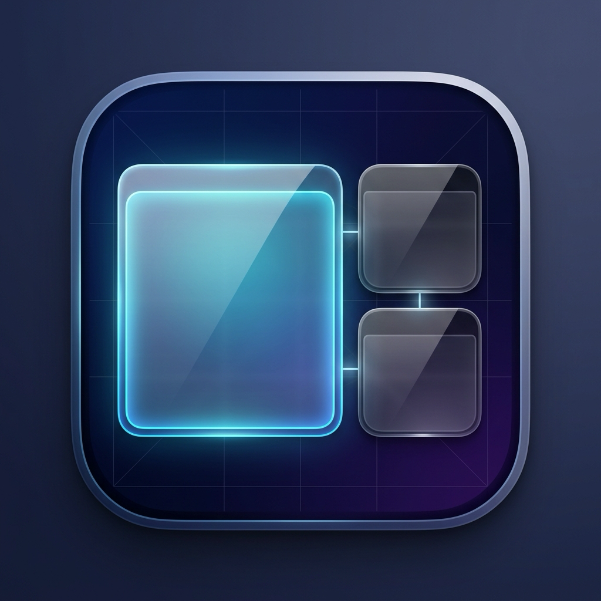

# SpaceTile 🚀

<div align="center">
  
  <p><strong>Ergonomic on-demand window tiling & intelligent display optimization for macOS.</strong></p>
  <p>Runs quietly in the background as a native daemon. Optimizes your active space on shortcut command.</p>
</div>

---

## ✨ Features

* ⚡ **Global Hyper-Key Shortcuts:**
  * **`Hyper + Space`** (`⌃⌥⇧⌘ + Space`): Instantly rearranges windows into an ergonomic dynamic grid.
  * **`Hyper + Return`** (`⌃⌥⇧⌘ + Return`): Designates the active window as **Master**. **Double-tap** quickly to clear the Master and return to a completely uniform, balanced grid!
  * **`Hyper + L`** (`⌃⌥⇧⌘ + L`): **Locks/Unlocks** the active window in place. Locked windows remain stationary; other windows tile around them.
  * **`Hyper + F`** (`⌃⌥⇧⌘ + F`): **Floats** the active window in the center and pins it **Always on Top**, excluding it from tiling.
  * **`Hyper + S`** (`⌃⌥⇧⌘ + S`): Opens the native SwiftUI **Settings GUI** as a centered floating panel.

* 📐 **Intelligent Multi-Display Layouts & Window Scoring (1–100):**
  * **Master Layout vs. Uniform Grid:** Choose between focused productivity layouts (with a 2/3 focus master) or completely balanced, uniform grids (2 cols, 3 cols, 2×2, 3×2, 4×2) when no master is set.
  * **Terminal Protection on 4K/Ultrawide:** Prevents terminal windows from being stretched across 62% (2400px+) of the display. Terminals request low weight (~30 score) and stay within an ergonomic ~1200px (1/3 column).
  * **Signature 3-Column Layout:** Centered Master with balanced side stacks for browser, editor, and terminals.
  * **Notes + Browser Side-by-Side:** Automatically provides an equal 50/50 reading split when notes and browsers are paired.

* 🛡️ **Robust macOS App Bundle & Real-Time Permissions:**
  * Built as a native application bundle (`~/Applications/SpaceTile.app`) with code signing and designated requirement `com.guppi.spacetile`.
  * **Zero Permission Drops:** Because macOS TCC tracks the bundle ID `com.guppi.spacetile`, Accessibility permissions persist across builds and restarts.
  * **Self-Aware Detection:** Live detection via `AXIsProcessTrustedWithOptions` and system accessibility notifications (`com.apple.accessibility.api`). The GUI updates immediately the moment you toggle permissions in System Settings!

* 💡 **Integrated Feedback & Bug Reporter:**
  * One-click "Feedback & Bugs" button in the Settings header and About tab.
  * Generates pre-formatted GitHub issues with sanitized diagnostic logs, display resolutions, and macOS version info.

---

## 🍺 Installation via Homebrew

The easiest way to install and stay updated:

```bash
# 1. Tap the SpaceTile repository
brew tap MNLBCK/tap

# 2. Install SpaceTile Cask
brew install --cask spacetile
```

To upgrade:
```bash
brew upgrade --cask spacetile
```

---

## 📥 Installation from Source

To build and install SpaceTile manually from GitHub:

```bash
# 1. Clone the repository
git clone https://github.com/MNLBCK/spacetile.git ~/Code/spacetile

# 2. Enter directory and run the installation script
cd ~/Code/spacetile
./install.sh
```

### What `install.sh` does automatically:
1. Compiles the optimized release binary with the Swift Package Manager.
2. Packages `SpaceTile.app` inside `~/Applications/` with the vector icon (`AppIcon.icns`).
3. Signs the bundle with the persistent identifier `com.guppi.spacetile`.
4. Creates a CLI symlink at `~/.local/bin/spacetile`.
5. Registers and launches the background daemon via LaunchAgent (`~/Library/LaunchAgents/com.guppi.spacetile.plist`).

---

## 🔐 Granting macOS Accessibility Permissions

SpaceTile requires Accessibility permissions to read window positions and move windows:

1. Open **System Settings** → **Privacy & Security** → **Accessibility** (Bedienungshilfen).
2. Toggle **SpaceTile** to **ON** (showing the geometric SpaceTile logo).
3. Verify in your terminal with:
   ```bash
   spacetile status
   ```
   You should see:
   ```text
   SpaceTile Status:
    - App Bundle:    Installed (~/Applications/SpaceTile.app)
    - CLI Symlink:   Active (~/Users/.../.local/bin/spacetile)
    - LaunchAgent:   Registered
    - Service:       Active (PID: ...)
    - Accessibility: Granted
   ```

---

## 💻 CLI Commands

The `spacetile` CLI tool is available from anywhere in your shell:

| Command | Description |
|---|---|
| `spacetile optimize` / `spacetile` | Rearranges windows in the current space immediately |
| `spacetile master` | Promotes the currently focused window to Master |
| `spacetile clear-master` | Clears Master and switches to uniform grid |
| `spacetile lock` | Toggles position lock for the currently focused window |
| `spacetile float` | Toggles floating Always-on-Top for focused window |
| `spacetile gui` | Opens the native Settings window |
| `spacetile feedback` | Opens GitHub to propose a new feature or improvement |
| `spacetile bug` | Gathers system info & logs and opens a pre-filled GitHub Bug Report |
| `spacetile status` | Displays live service, app bundle, and permission status |
| `spacetile restart` | Safely restarts the background LaunchAgent daemon |
| `spacetile install` | Re-bundles and registers `SpaceTile.app` and LaunchAgent |
| `spacetile uninstall` | Completely stops and removes SpaceTile and its LaunchAgent |

---

## ⚙️ Configuration

Configuration is stored in `~/.config/spacetile/config.json`. You can edit it manually or visually via the GUI (**`Hyper + S`**):

* **Live Canvas:** Drag & drop window tiles to swap positions; double-click or right-click to set or clear Master.
* **Shortcuts:** Customize any of the global hotkeys with the interactive "Record New" recorder.
* **Weights & Scores:** Adjust scores (1–100) per app or per individual window for intelligent column allocation.
* **Spacing & Motion:** Adjust gap, margin, single-window mode, and toggle smooth gliding motion.

---

## 🗑️ Uninstallation

If installed via Homebrew:
```bash
brew uninstall --cask spacetile
```

If installed manually:
```bash
spacetile uninstall
```
